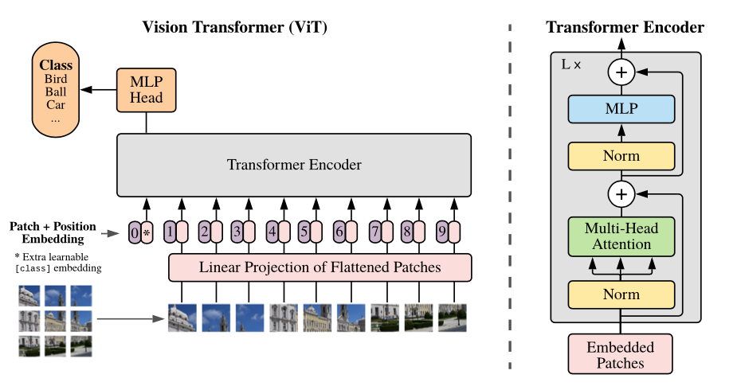

# Vision Transformer from Scratch

An implementation of a **Vision Transformer (ViT)** from scratch using PyTorch for image classification on the Fashion-MNIST dataset.

The goal of this project is to understand the internal architecture of Vision Transformers by implementing their main components step by step, rather than relying on pre-built transformer models.

## Implementation

The model is built from individual components:

- **Patch Embedding** — converting images into sequences of patch embeddings using `Conv2d`.
- **Multi-Head Self-Attention** — implementing QKV projections and scaled dot-product attention.
- **MLP** — feed-forward network for token-wise feature transformation.
- **Transformer Encoder** — combining attention, MLP, layer normalization, and residual connections.
- **Vision Transformer** — assembling the complete architecture with positional embeddings, a CLS token, and a classification head.

## Dataset

The project uses **Fashion-MNIST**, containing 28×28 grayscale images from 10 clothing categories.

## Experiments

After implementing and training the model, the project will explore:

- The effect of positional embeddings on classification performance.
- The impact of different patch sizes.
- Attention visualization using Attention Rollout.

## Project Structure

- `ViT_from_scratch.ipynb` — implementation, training, and experiments.
- `images/` — architecture diagrams and illustrations.

---

*This implementation is based on a homework assignment from [Deep Learning School (DLS)](https://stepik.org/course/273213/syllabus).*
